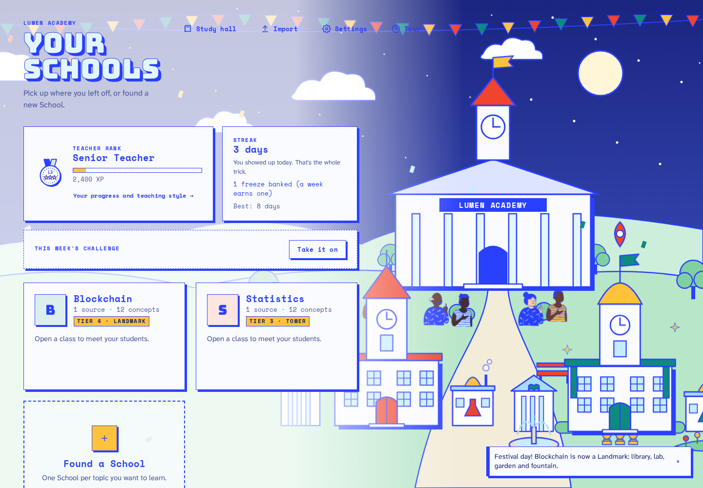
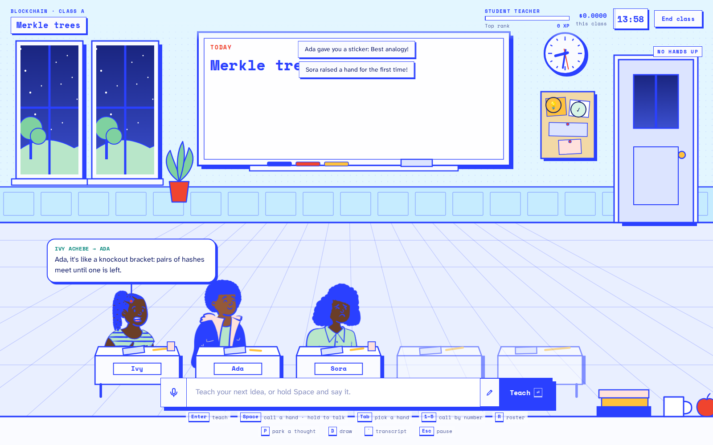
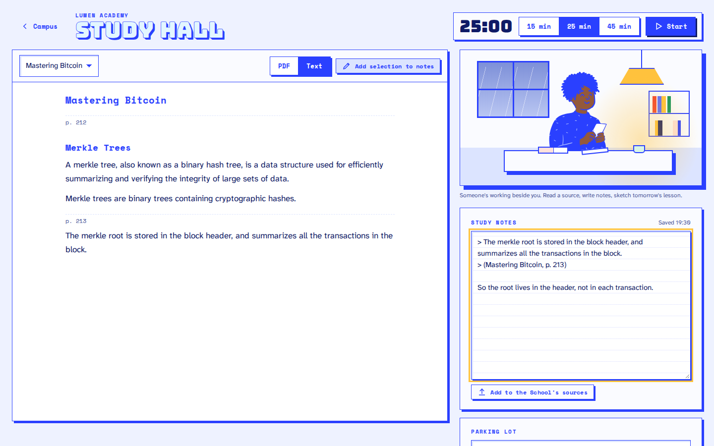
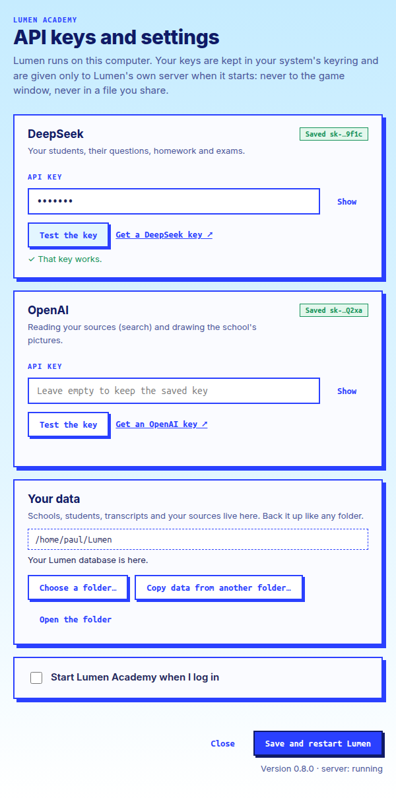

# Lumen Academy

**Learn by teaching.** Found a School for any topic you're studying, add your own sources, and teach a class of AI students who only know what you've taught them. They raise their hands when you're vague, repeat your mistakes back to you and sit exams marked against your sources. Their confusion shows you exactly where your own understanding is thin.

Designed for an ADHD brain: short classes, a one-button start, gentle streaks and breaks, a study hall with company, and no shame mechanics.



## Features

- **Schools from your own material:** PDFs, Markdown and notes, slides (`.pptx`), Anki decks, YouTube talks, web articles, and photos of handwritten notes (read on your machine). The curriculum is built book by book and chapter by chapter, so big books keep their topics; each book shows which chapters were taught or skipped, and you can edit it all.
- **Schools in a series:** a new School can continue an earlier one. Its concepts build on the earlier School's, the campus joins them with a path, and a class moves on with the same students.
- **A class that mirrors you:** 4–15 students, each with a personality, a voice and a growth arc. Students never see your sources; everything they know came from you. Comprehension is computed by the game, not guessed by a model.
- **Many ways to teach:** classic lessons, 3-minute micro-lessons, Socratic questioning, teach-back, an analogy lab, an "explain it like I'm 5 → expert" ladder, a substitute teacher, debates and guest lecturers. Draw on the board and your diagram is read as structure.
- **Homework, exams and an honest debrief:** what you under-taught, what you got wrong, and one-click re-teach.
- **Memory that fades:** concepts slip over time, so the lobby suggests today's best class before your students forget.
- **Voice:** hold Space (or the mic button) to teach out loud. Students answer in their own voices: generated on your computer on the desktop, and by the phone's own voices on Android.
- **Progress you can see:** a campus that grows from blueprint to landmark, room upgrades, class photos, weekly challenges, progress charts and a profile of your teaching style.
- **Study hall that gets you ready to teach:** the concept each class meets next and the passages behind it; a practice explanation, checked against the key facts; what to look up (questions you left hanging, your mistakes, what students believe wrongly). Read a chapter at a time with a focus band and read-aloud. A student from your class leans over with a question now and then, your classmates study at the next desks, and focus blocks with an intention, a real break and minutes that keep your streak.
- **Desktop and phone:** every scene works on a big screen, and on a phone held upright or on its side.

| Teaching a class | The study hall |
|---|---|
|  |  |

## Install

Download the latest release from the [Releases page](https://github.com/backendpapa1/lumen-academy/releases):

- **Ubuntu, Debian, Mint, Pop!_OS:** `Lumen Academy_<version>_amd64.deb`. Double-click it, or run `sudo apt install "./Lumen Academy_<version>_amd64.deb"`.
- **Any other Linux:** `Lumen Academy_<version>_amd64.AppImage`. Make it executable (`chmod +x`), then run it.
- **Android (64-bit ARM phones, Android 10 or newer):** `lumen-academy-<version>.apk`. Open it on the phone and allow installing from that source. The first start unpacks the app (about 20 seconds); after that it opens in a second or two. It needs about 350 MB free.

On first launch, the configurator asks for two API keys:

| Key | What it's for | Get one |
|---|---|---|
| DeepSeek | Your students, their questions, homework and exams | [platform.deepseek.com](https://platform.deepseek.com/api_keys) |
| OpenAI | Searching your sources and drawing the school's pictures | [platform.openai.com](https://platform.openai.com/api-keys) |

Both are pay-as-you-go. Lumen shows what each class cost, and you can set monthly caps in Settings. The keys stay in your system keyring and are only passed to Lumen's own server on your computer. To change them later, use the tray icon → **API keys and settings…**.

Your data lives in `~/Lumen` unless you choose another folder. On Android, the keys page opens on first start, the keys are kept in the app's encrypted storage, and your data stays inside the app.



## Privacy

Lumen is local-first:
- The server runs on your machine and listens on `127.0.0.1` only.
- Your sources, students and transcripts stay in your data folder.
- Text goes to DeepSeek and OpenAI only for the calls that need them.
- Speech recognition (Whisper), student voices (Kokoro) and reading photos of notes (Tesseract) all run locally.

## Develop

Requirements: Node 24 (see `.nvmrc`), pnpm 11, and for the desktop app, Rust plus the [Tauri Linux prerequisites](https://v2.tauri.app/start/prerequisites/).

```bash
pnpm i
cp .env.example .env          # add OPENAI_API_KEY and DEEPSEEK_API_KEY
pnpm db:migrate
pnpm models:check             # checks the configured models answer
pnpm dev                      # client on http://localhost:5173, server on 5174
```

| Command | What it does |
|---|---|
| `pnpm check` | Type-check, lint, format check and unit tests |
| `pnpm test:e2e` | Playwright tests (starts the server and client itself) |
| `pnpm eval:agents` | Agent evaluations: knowledge leaks, mirror accuracy |
| `pnpm --filter @lumen/desktop package` | Builds the desktop app (`.deb` and AppImage) |
| `pnpm --filter @lumen/desktop android:build` | Builds the signed Android APK (arm64) |

Speech in development needs local models: `pnpm speech:check` reports what's set up.

The e2e tests run every flow three times: on the desktop, on a phone held upright (390 × 844) and on its side (844 × 390). `pnpm test:e2e --project=phone-portrait` runs just one of them.

### Android

The Android app is the same Tauri 2 project as the desktop app (`apps/desktop`), with the server and its Node runtime packed inside the APK. To build it you need the Android SDK and NDK, and Java 17:

```bash
export ANDROID_HOME=$HOME/Android/Sdk
export NDK_HOME=$ANDROID_HOME/ndk/<version>
export JAVA_HOME=/usr/lib/jvm/java-17-openjdk-amd64
pnpm --filter @lumen/desktop android:build    # or android:debug
```

Release builds are signed with a keystore kept outside the repo: set `storeFile`, `storePassword`, `keyAlias` and `keyPassword` in `~/.config/lumen-android/keystore.properties` (or `LUMEN_KEYSTORE_*` variables). Every update must be signed with the same key, so keep a backup of it.

### Layout

```
apps/client     The game: DOM + SVG scenes, Open Peeps students, no framework
apps/server     Fastify on 127.0.0.1, agents (LangChain), SQLite (Drizzle, sqlite-vec, FTS5)
apps/desktop    Tauri 2 shell (Rust) for the desktop and Android, tray configurator, packaging
packages/shared Types and Zod schemas shared by client and server
config/         Models, prices, game tuning and art prompts (YAML)
e2e/            Playwright tests
```

### Stack

TypeScript, Vite, Fastify, LangChain, DeepSeek, OpenAI (embeddings and images), SQLite with Drizzle, sqlite-vec and FTS5, Kokoro and Whisper for speech, Tauri 2 (Rust) for the desktop and Android apps.

## Credits

- Students are drawn with [Open Peeps](https://www.openpeeps.com/) by Pablo Stanley (CC0).
- The test fixtures quote *Mastering Bitcoin* (third edition) by Andreas M. Antonopoulos and David A. Harding (CC BY-SA 4.0), as noted in `fixtures/blockchain-ch1/LICENSE.md`.
